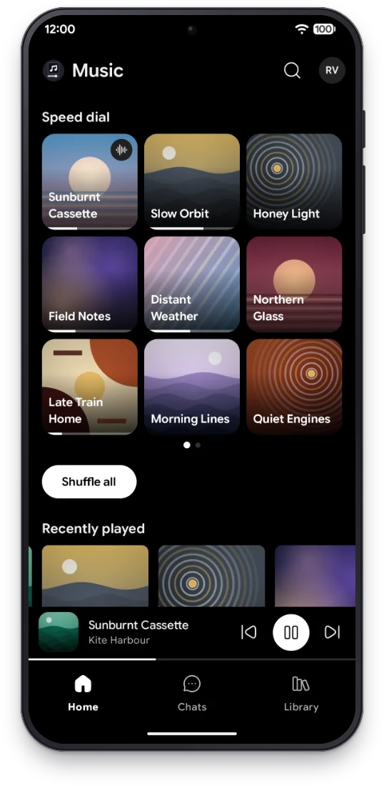
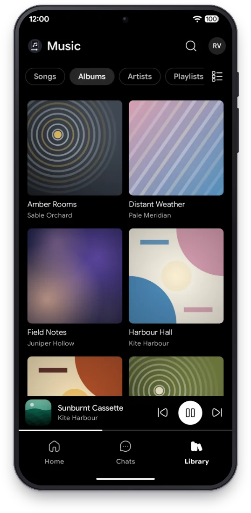
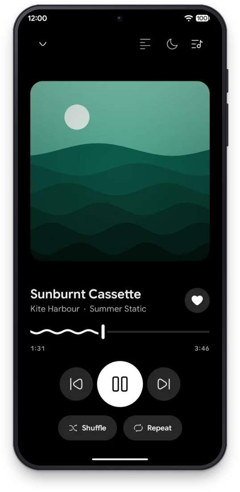
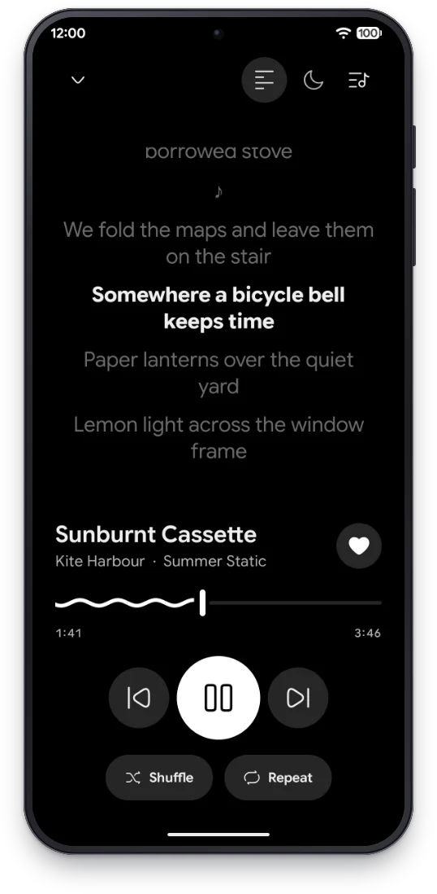

<p align="center">
  <picture>
    <source media="(prefers-color-scheme: dark)" srcset="art/logo-white.svg" />
    
  </picture>
</p>

<h1 align="center">TMPlayer Music</h1>

<p align="center">A player for the audio files already in your own Telegram chats. It streams while the file downloads.</p>

<p align="center"><sub>TMPlayer Music is a free, open source, unofficial player for Android that plays the audio files in the Telegram chats you pick, with your own account. Unofficial, not affiliated with Telegram.</sub></p>

<p align="center">
  
  
  
</p>

<p align="center">
  <a href="https://github.com/sponsors/dracu-lah"></a>
  <a href="https://buymeacoffee.com/nevil.dev"></a>
</p>

---

TMPlayer Music plays the audio files you already have in your own Telegram chats: the tracks you
saved to Saved Messages, or the ones in a group or channel you are in. You pick the chats, it finds
the tracks in them and plays them like a music player, starting within seconds while the file is
still downloading. It is the sibling of [TMPlayer](https://github.com/dracu-lah/TMPlayer), the
player for the videos in your chats, and built on the same engine.

No server of ours sits between you and Telegram, no account except yours, and nothing is scanned
until you pick the chat.

## Screenshots

<p align="center">
  
  
  
  
</p>

<p align="center"><sub>Home, Albums, Now Playing and Lyrics. The screenshots use demo data: every track, album and artist name in them is invented.</sub></p>

<!-- Made by scripts/prepare-screenshots.py from the captures of scripts/screenshots.sh. -->

## What it reads, and what it does not

- **It reads** the chats you pick, and only the audio in them: music files and audio sent as
  documents (MP3, FLAC, M4A, Ogg, Opus, WAV, AIFF). Voice messages and short clips are left out.
- **It reads the start of each file** to find its title, artist, album and cover from the file's own
  tags, on Wi-Fi by default.
- **It keeps on the device** the library index, your playlists, favourites and play counts, the queue,
  and a cache of audio whose size you set.
- **It does not read** your messages, your contacts, or any chat you did not pick. It does not post,
  send, react or mark anything as read on your behalf. It does not search public channels, and it has
  no catalogue and no recommendations of what to listen to.

## What it does today

The app is in early testing. What is built:

- **Sign in** with your phone number (with a country picker), the code Telegram sends, your two-step
  password if you have one, or a QR code scanned from the Telegram app on another device.
- **Pick the chats** with music on the first run, and change them later in Manage chats.
- **A chat as a playlist:** each chat opens with its tracks in message order, Oldest first or Newest
  first, with Play and Shuffle.
- **One library** across your chats: Songs, Albums and Artists, an A to Z bar, and search with your
  recent searches. Artists credited together are split into each artist. The same song in several
  files is one row with its versions behind it.
- **Tags** from ID3, FLAC, Ogg, MP4, WAV and AIFF files, with the text encoding detected, so titles in
  any script read correctly.
- **Streaming playback** that starts before the download finishes and seeks without waiting for it,
  with FFmpeg decoders for what the phone lacks (FLAC and Opus before Android 8, ALAC).
- **Plays in the background** with the notification, lock screen and headset controls. The queue is
  saved and comes back paused when you open the app again. Nothing starts playing by itself when a
  headset or a car connects.
- **Home** with Continue, Recently added, Recently played and Favourites. Playlists and Favourites.
- **Lyrics** from the file's tags or from a `.lrc` file with the same name in the same chat, synced
  line by line when they are timed.
- **Sleep timer** by minutes or at the end of the track.
- **Your storage:** a cache limit, how much is used and free, and Free up space, which deletes cached
  audio and never touches anything in Telegram.
- **Send logs** from Settings and from every error, with chat names, ids, file names and phone numbers taken out first.

Planned, not built yet: a TV app, a phone remote for the TV, Cast, online lyrics lookups and
Keep offline.

## Runs on

**Android 6.0 and up**, phones and tablets. Low-end phones are a target, not an afterthought.

## Install

TMPlayer Music is not in any store yet. Builds are published on the
[Releases](https://github.com/dracu-lah/tmplayer-music/releases) page; the first ones are test
versions (`vX.Y.Z-beta.N`). On the phone, download `TMPlayerMusic-<version>.apk`, open it and allow
the install. [INSTALL.md](INSTALL.md) has every step and what to do when something goes wrong.

## Build it yourself

You need JDK 21, the Android SDK with platform 37, and your own free Telegram credentials from
[my.telegram.org](https://my.telegram.org) in `local.properties` (gitignored):

```properties
sdk.dir=/path/to/Android/Sdk
TG_API_ID=1234567
TG_API_HASH=your_api_hash
```

Without them the app still builds and runs, and says so on the sign in screen. Never use somebody
else's credentials, and never put yours in a commit or a pull request.
[.env.example](.env.example) lists every value the build reads, including the release signing
values, and how to set them as repository secrets.

```bash
./gradlew :core:jvmTest :app:testDebugUnitTest   # the tests
./gradlew :app:assembleDebug                     # a debug APK, signed with your own debug key
```

A release build (`./gradlew :app:assembleRelease`) is signed only when a `keystore.properties` file
(gitignored) points at your keystore; see [CONTRIBUTING.md](CONTRIBUTING.md).

## Privacy

- The app talks to Telegram through TDLib with your own account. Everything it learns stays on your
  device.
- Online lyrics lookups are not in the app yet. When they come, they are **off until you turn them
  on**, and go through our own gateway, which sends only the track's title, artist, album and
  duration. Never a chat name, a chat id, a file name or anything about your account.
- Send logs only shares a file when you choose to, through the share sheet, to wherever you pick.
  Chat names, ids, file names and phone numbers are removed from it first.
- No ads, no analytics, no crash reporting service.

## Read more

- [Screenshots](#screenshots): Home, Albums, Now Playing and Lyrics.
- [Install guide](INSTALL.md): installing the APK, updating, troubleshooting.
- [Contributing](CONTRIBUTING.md): setup, ground rules, style, how to report an issue.
- [Security policy](SECURITY.md): how to report a security problem privately.
- [Code of conduct](CODE_OF_CONDUCT.md).
- [Third-party notices](THIRD_PARTY_NOTICES.md): libraries, their licences and sources.

## Support

TMPlayer Music has no ads of its own and no paid tier. If it helps you,
[sponsor it on GitHub](https://github.com/sponsors/dracu-lah) or
[buy me a coffee](https://buymeacoffee.com/nevil.dev). Either way, a star helps the next person trust
it. It is all voluntary: every feature is free for everyone.

## Legal

Unofficial client. Not affiliated with, endorsed by, or connected to Telegram FZ-LLC. It uses the
official Telegram API through TDLib with your own Telegram account, as
[permitted for third-party clients](https://core.telegram.org/api/obtaining_api_id).

TMPlayer Music does not provide any audio, recommend chats or channels, or bypass access controls. It
plays what is already in the chats you are in. Use it only with content you own or are authorised to
access. See [tmplayer.org/legal](https://tmplayer.org/legal) for lawful use and takedown requests.

## Licence

[GNU GPL-3.0-or-later](LICENSE) © 2026 dracu-lah, with an
[additional permission for OpenSSL](LICENSE-OPENSSL-EXCEPTION.md) (TDLib links OpenSSL). Parts of the
code come from TMPlayer, under the same licence. Bundled libraries and their sources:
[THIRD_PARTY_NOTICES.md](THIRD_PARTY_NOTICES.md).
